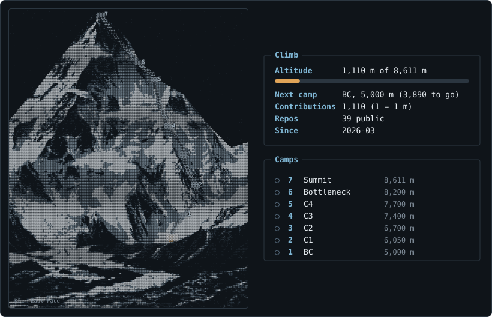
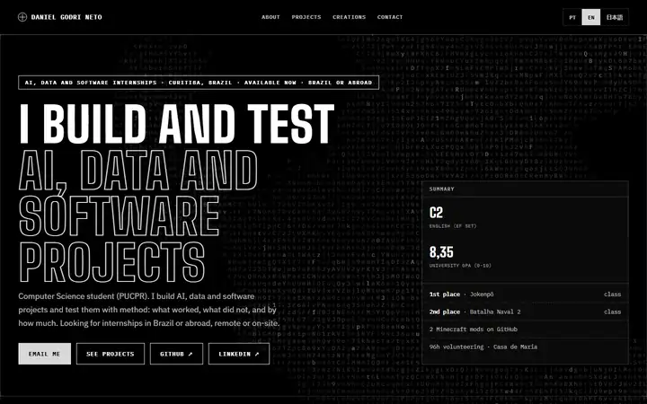
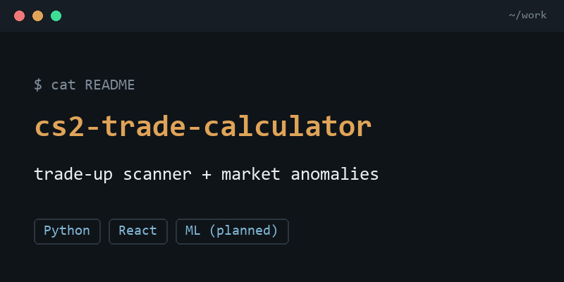
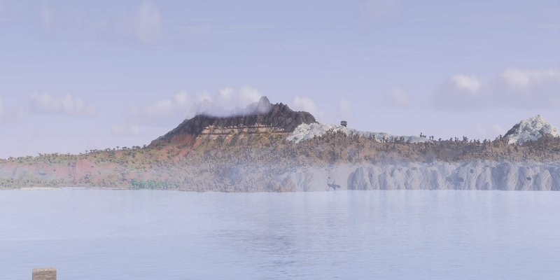
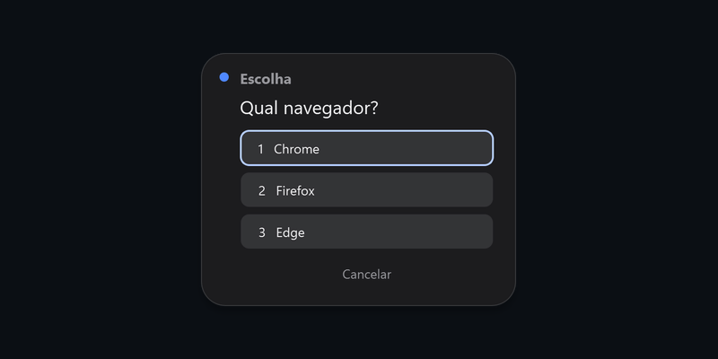
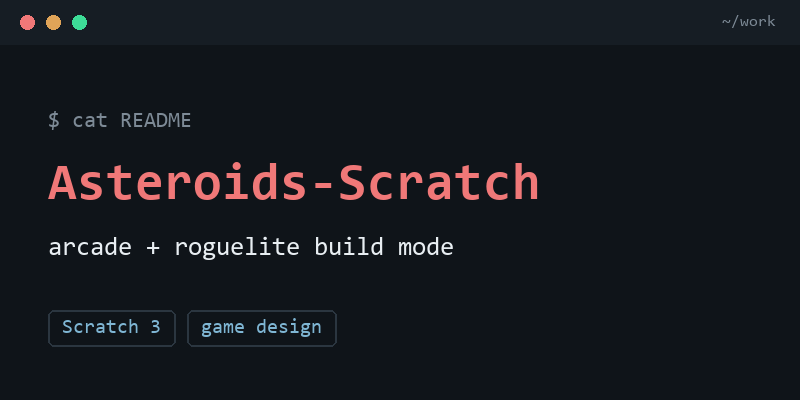
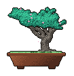

  <picture>
    <source media="(prefers-color-scheme: light)" srcset="./climb-card-light.svg">
    
  </picture>
    
  <a href="#portfolio">Portfolio</a> &nbsp;·&nbsp; <a href="#selected-work">Work</a> &nbsp;·&nbsp; <a href="#stack">Stack</a> &nbsp;·&nbsp; <a href="#education">Education</a> &nbsp;·&nbsp; <a href="#contact">Contact</a>

**How to read the card.** The climber starts at K2 Base Camp (5,000 m) and climbs the east face as my GitHub contributions grow (commits, pull requests, issues, reviews). 8,611 contributions reach the 8,611 m summit, so one contribution is about 0.42 m. Amber is the route already climbed, blue is what is left. Updated daily.

I'm a Computer Science student at PUC-PR (Curitiba, Brazil) building tools at the edge of games, graphics and applied AI. I like projects where something has to be measured, not just shown: a culling pass that has to fit in a frame, a scanner that has to be right about prices, a voice agent that has to pick the correct action.

*Em português:* estudo Ciência da Computação na PUC-PR e construo ferramentas entre jogos, gráficos e IA aplicada. Prefiro projetos em que dá para medir o resultado.

## Portfolio

  
    
  
   Trilingual (PT, EN, 日本語). Click the preview to open it.

## Selected work

<table>
  <tr>
    <td width="50%" valign="top">
       
      <b><a href="https://github.com/DanielGodriNeto/cs2-trade-calculator">cs2-trade-calculator</a></b> &nbsp;Python 
      Read-only scanner for profitable CS2 trade-up contracts and Steam Market anomalies, with a React dashboard. It never logs into Steam or places orders. 
      <a href="https://cs2-trade-calculator.onrender.com">Live demo</a>
    </td>
    <td width="50%" valign="top">
       
      <b><a href="https://github.com/DanielGodriNeto/Godri-Culling">Godri-Culling</a></b> &nbsp;Java 
      Sodium add-on for Minecraft that moves terrain frustum and occlusion culling to GPU compute shaders, with indirect draws and no CPU readback. Falls back to stock Sodium. 
      <a href="https://github.com/DanielGodriNeto/Godri-Culling">Source</a>
    </td>
  </tr>
  <tr>
    <td width="50%" valign="top">
       
      <b><a href="https://github.com/DanielGodriNeto/local-ai-agent">local-ai-agent</a></b> &nbsp;Python 
      Push-to-talk voice agent: local Whisper, a small ONNX classifier that picks an allowlisted action, and escalation to Claude Code for complex tasks, after confirmation. 
      <a href="https://github.com/DanielGodriNeto/local-ai-agent">Source</a>
    </td>
    <td width="50%" valign="top">
       
      <b><a href="https://github.com/DanielGodriNeto/Asteroids-Scratch">Asteroids-Scratch</a></b> &nbsp;Scratch 
      Asteroids remake with an arcade mode and a roguelite Build mode. Made for the Apple Developer Academy PUCPR selection. 
      <a href="https://github.com/DanielGodriNeto/Asteroids-Scratch">Source</a>
    </td>
  </tr>
</table>

More: [portfolio](https://resume-portifolio-vagas-ebd126.gitlab.io/) (PT / EN / JP), [Cookie-Clicker-Mods](https://github.com/DanielGodriNeto/Cookie-Clicker-Mods), [Jogo-battleship](https://github.com/DanielGodriNeto/Jogo-battleship).

## Stack

**Languages** &nbsp;    

**AI and ML** &nbsp;  

**Games and graphics** &nbsp;  

**Tools** &nbsp;  

## Education

- B.Sc. Computer Science, PUC-PR (2026 to present). 1st place on the Rock-Paper-Scissors project and 2nd place on Battleship in Algorithmic Reasoning.
- English C1 (EF SET). Japanese in progress: [daily study notes](https://github.com/DanielGodriNeto/Guia-de-estudos-Portugues-e-Ingles-para-Japones) with spaced repetition.

Certifications

 

Google AI Professional Certificate, Foundations of Cybersecurity (Google), Empreendedorismo (SEBRAE, 4 tracks).

## Contact

  

   
  Grown from my commit history by <a href="https://github.com/egorthinks/git-bonsai">git-bonsai</a>.

